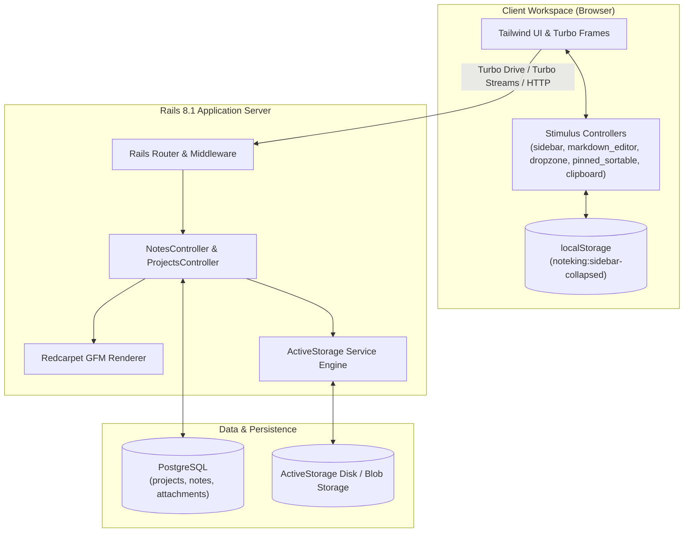

<p align="center">
  
</p>

# Noteking

<p align="center">
  <strong>A local-first Markdown note-taking studio and workspace for developers.</strong>
</p>

<p align="center">
  <a href="https://ruby-lang.org"></a>
  <a href="https://rubyonrails.org"></a>
  <a href="https://hotwired.dev"></a>
  <a href="https://tailwindcss.com"></a>
  <a href="https://www.postgresql.org"></a>
  
</p>

---

## Overview

Software engineers and architects frequently juggle technical designs, architecture decision records (ADRs), meeting takeaways, and code snippets scattered across scratchpads, notes apps, and one-off gists.

**Noteking** is a dedicated, distraction-free desktop note workbench designed to run locally. It lets you organize, author, preview, and review Markdown notes grouped by project or kept as standalone scratchpads—with instant one-click markdown copying, live split-screen previewing, drag-and-drop context file attachments, and pinned note management with custom ordering.

---

## Key Features

### 📁 Project & Standalone Organization
- **Structured Hierarchy**: Organize notes inside dedicated projects (e.g., `Architecture Decisions`, `API Specifications`, `Weekly Syncs`).
- **Standalone Notes**: Keep quick scratchpad notes without forcing project assignment.
- **Fluid Assignment**: Reassign any note to any project or back to standalone anytime via a quick dropdown.
- **Real-Time Search**: Instant client-side note and project filtering from the persistent sidebar.

### 📝 Markdown Editing with 3 View Modes
- **Preview Mode**: Clean GitHub Flavored Markdown (GFM) rendering powered by `Redcarpet` with dark-mode developer typography, fenced syntax highlighting blocks, and GitHub-style tables.
- **Edit Mode**: Monospaced raw Markdown editor with debounced auto-save and visual save status indicators.
- **Split Mode**: Side-by-side split screen providing live editor feedback alongside real-time rendered markdown.
- **Save Shortcut**: `⌘S` / `Ctrl+S` instant save from anywhere in the editor.

### ⚡ Zero-Latency One-Click Copy
- **Note Toolbar**: Prominent `Copy Markdown` button on the note workspace header.
- **Note Cards**: Quick `Copy` action directly on every card in project and index listings.
- **Immediate Feedback**: Instant visual cue transitioning to `Copied!` with highlight styling.

### 📌 Pinned Notes & Reordering
- **Sidebar Quick Access**: Pin your most critical notes to the top of the sidebar.
- **Drag-and-Drop Reordering**: Smooth client-side reordering persisted to the database via `pinned_position`.
- **Global Toggle**: Quick-pin or unpin notes directly from cards or detail toolbars.

### 📎 ActiveStorage Dropzone Context Attachments
- **Drag-and-Drop Uploads**: Direct ActiveStorage file uploads with drag-and-drop dropzones on note pages without full-page reloads.
- **Rich Attachment Previews**: Image thumbnail rendering, formatted human-readable file sizes, download links, and instant attachment purging via Turbo Streams.

### 🖥️ Collapsible Workspace & Mobile Ergonomics
- **Collapsible Sidebar**: Toggle with `⌘\` / `Ctrl+\` or via the top-bar button.
- **Preference Persistence**: Sidebar collapse state is remembered across refreshes and page transitions via `localStorage`.
- **Mobile First-Class Drawer**: On mobile screens (< 768px), the sidebar expands to full width with main view masking, automatically closing upon link selection for seamless navigation.

### 🚀 REST API & OpenAPI 3.1
- **RESTful API & OpenAPI 3.1**: Full programmatic endpoints for notes, projects, attachments, search, and markdown rendering.

---

## Architecture & Tech Stack

Noteking is built on a lightweight, high-performance Rails 8 stack engineered for maximum developer ergonomics without the complexity of a separate single-page application framework.

| Layer | Technology | Purpose |
| :--- | :--- | :--- |
| **Backend** | Ruby 3.4.4 / Rails 8.1.4 | Core MVC engine, Turbo stream responses, ActiveStorage services |
| **Database** | PostgreSQL | Relational storage for projects, notes, pinned positions, and attachments |
| **Frontend Reactive** | Hotwire (Turbo 8 + Stimulus) | SPA-speed transitions, frame updates, and modular JavaScript controllers |
| **Styling** | Tailwind CSS v4 | High-performance compiled modern utility-first stylesheet with amber/gold accents |
| **Markdown Engine** | Redcarpet 3.6 | Server-side GitHub Flavored Markdown parsing with HTML sanitization |
| **Asset Pipeline** | Propshaft + Importmap | Zero-Node ESM JavaScript loading with instant startup |
| **Testing** | Minitest + Capybara + Selenium | Full unit, integration, and end-to-end browser system test coverage |

### System Flow Diagram



---

## Keyboard Shortcuts

| Shortcut | Action | Scope |
| :--- | :--- | :--- |
| `⌘ \` / `Ctrl + \` | Toggle Sidebar (Collapsed / Expanded) | Global |
| `⌘ S` / `Ctrl + S` | Force Save Note Content | Note Edit / Split Modes |
| `Click Nav Link` | Auto-close Sidebar Drawer | Mobile View (< 768px) |

---

## Design Philosophy & Engineering Decisions

- **Local-First & Zero-Auth by Design**: Personal technical notes shouldn't require creating third-party cloud accounts, paying subscriptions, or dealing with network latencies. Noteking is designed to run locally on your development machine, keeping your intellectual property and confidential notes private.
- **Hotwire Over Heavy SPAs**: By leveraging Rails 8 Turbo Frames, Turbo Streams, and targeted Stimulus controllers, Noteking delivers the snappy, single-page responsiveness of React or Vue without the overhead of client-side state hydration, duplicate routing, or Node build step dependencies.
- **Direct ActiveStorage Attachments**: Note contexts often require sample payloads, diagrams, logs, or image reference fixtures. Integrating directly with ActiveStorage allows notes to bundle context files without relying on external cloud file hosting.

---

## Local Development Quickstart

### Prerequisites
- **Ruby**: `3.4.4` (managed via `rbenv`, `asdf`, or `mise`)
- **PostgreSQL**: `14+` running locally
- **Bundler**: `bundle -v`

### 1. Setup Dependencies & Database
Run the setup script to install gems, prepare the database, and compile assets:
```bash
bin/setup
```

*(Alternatively, run step-by-step)*:
```bash
bundle install
bin/rails db:prepare
```

### 2. Seed Sample Data (Optional)
Populate sample projects and notes:
```bash
bin/rails db:seed
```

### 3. Start the Development Server
Launch the unified Tailwind watcher and Puma server:
```bash
bin/dev
```
Open your browser at [http://localhost:3000](http://localhost:3000).

---

## Running the Test Suite

Noteking maintains full test coverage across models, controllers, and browser interactions.

```bash
# Run unit and controller test suite
bin/rails test

# Run browser system tests (Capybara + headless Chrome)
bin/rails test:system

# Run RuboCop linter (Rails Omakase style)
bin/rubocop

# Security audits
bin/brakeman --no-pager
bin/bundler-audit
```

---

## REST API Specification

Noteking includes a complete versioned RESTful JSON API (`/api/v1`) with full OpenAPI 3.1.0 specifications, designed for programmatic integration.

### OpenAPI Specification
- **Live Endpoint**: `GET http://localhost:3000/api/v1/openapi.json`
- **Specification File**: [`openapi.json`](file:///Users/leonid/src/noteking/openapi.json) located in repository root

### API Endpoints Summary

| Method | Endpoint | Description |
| :--- | :--- | :--- |
| `GET` | `/api/v1/stats` | System statistics (total notes, projects, attachments) |
| `GET` | `/api/v1/openapi` | OpenAPI 3.1.0 schema specification |
| `POST` | `/api/v1/markdown/render` | Render raw Markdown text to sanitized HTML |
| `GET` | `/api/v1/projects` | List projects with note counts and search (`?q=...`) |
| `POST` | `/api/v1/projects` | Create a new project |
| `GET` | `/api/v1/projects/:id` | Get project details and associated notes |
| `PATCH` | `/api/v1/projects/:id` | Update project attributes |
| `DELETE` | `/api/v1/projects/:id` | Delete project (preserves notes as standalone) |
| `GET` | `/api/v1/notes` | List notes (filter by `project_id`, `scope`, `pinned`, `q`) |
| `POST` | `/api/v1/notes` | Create a new note |
| `GET` | `/api/v1/notes/:id` | Get note details (`?render_markdown=true` for HTML) |
| `PATCH` | `/api/v1/notes/:id` | Update a note |
| `DELETE` | `/api/v1/notes/:id` | Delete a note |
| `PATCH` | `/api/v1/notes/:id/toggle_pin` | Toggle pinned state of a note |
| `PATCH` | `/api/v1/notes/reorder_pinned` | Reorder pinned notes (`{ note_ids: [...] }`) |
| `GET` | `/api/v1/notes/:id/attachments` | List note attachments with metadata and URLs |
| `POST` | `/api/v1/notes/:id/attachments` | Upload file attachments (`multipart/form-data`) |
| `DELETE` | `/api/v1/notes/:id/attachments/:att_id` | Purge attachment |

---

## License

This project is open-source and available under the MIT License.
